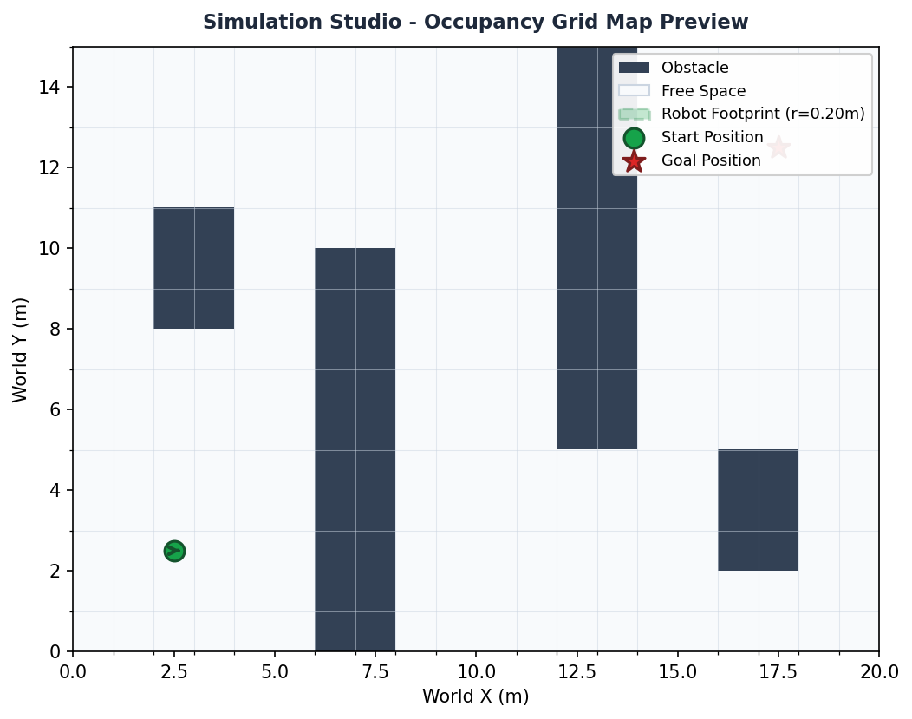
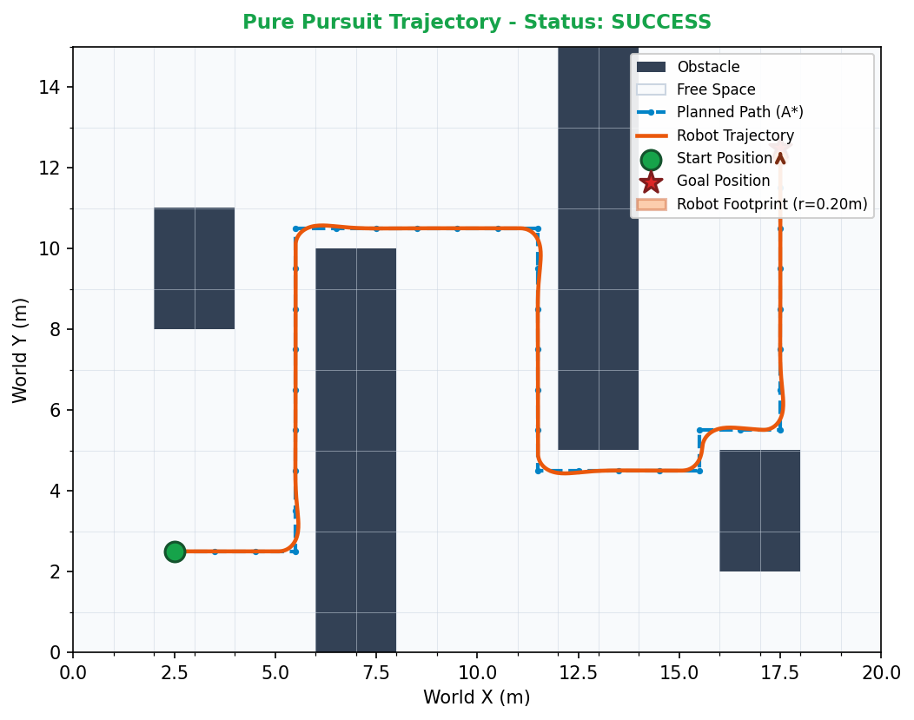

# AI-Based Autonomous Navigation System

A deterministic, industrial-grade 2D autonomous mobile robot navigation simulator and interactive evaluation platform written in Python.

---

## Executive Summary

The AI-Based Autonomous Navigation System is a software platform designed to model, test, and evaluate autonomous mobile robot navigation across discrete 2D occupancy grid environments. The system implements the classical robotics sense-plan-act control loop without external hardware dependencies, GPU requirements, or non-deterministic machine learning models.

Key capabilities include:
- Global path planning via 4-connected A* graph search.
- Continuous-time unicycle kinematics modeling linear velocity and yaw rate.
- Dual path tracking controllers: Heading Proportional control and geometric Pure Pursuit arc tracking.
- Continuous multi-sample motion collision checking against circular robot footprints.
- An interactive web application built with Streamlit featuring real-time map preview, in-browser obstacle editing, and trajectory telemetry.
- A deterministic 7-scenario benchmark suite supporting automated regression testing and parameter tuning.
- A test suite consisting of 276 unit and integration tests with 100% pass rate.

---

## System Architecture

The software architecture follows a modular, decoupled design where environment modeling, path planning, kinematics, trajectory tracking, and collision verification operate through clearly defined interfaces.

```
+-----------------------------------------------------------------------+
|                         Central Configuration                         |
|                      configs/default_config.json                      |
+-----------------------------------------------------------------------+
                                   |
                                   v
+-----------------------+     +-----------------------+     +-----------------------+
|    Occupancy Grid     | --> |    Known-Map Sense    | --> |    A* Path Planner    |
|   (src/environment)   |     |    (src/perception)   |     |   (src/path_planner)  |
+-----------------------+     +-----------------------+     +-----------------------+
            |                                                           |
            |                                                           v
            |                                               +-----------------------+
            |                                               |   Tracking Controller |
            |                                               |  (Heading / Pursuit)  |
            |                                               +-----------------------+
            |                                                           |
            |                                                           v
            |                 +-----------------------+     +-----------------------+
            |                 |   Collision Checker   | <-- |  Unicycle Kinematics  |
            +---------------> |(src/collision_checker)|     |     (src/robot)       |
                              +-----------------------+     +-----------------------+
                                          |
                                          v
                              +-----------------------+
                              |   Simulation Engine   |
                              |   (src/simulator.py)  |
                              +-----------------------+
                                          |
                        +-----------------+-----------------+
                        |                                   |
                        v                                   v
            +-----------------------+           +-----------------------+
            | 2D Visualizer Pipeline|           | Quantitative Metrics  |
            | (src/visualization.py)|           |   (src/metrics.py)    |
            +-----------------------+           +-----------------------+
```

### Component Roles

1. Environment Representation (`src/environment.py`): Models 2D space as an OccupancyGrid supporting discrete grid coordinates `(row, col)` and continuous world coordinates `(x, y)` in meters, with arbitrary origin offsets and physical cell resolutions.
2. Perception Adapter (`src/perception.py`): Ingests the ground truth occupancy matrix to construct global traversability representations for planning algorithms.
3. Global Path Planner (`src/path_planner.py`): Implements the A* graph search algorithm with Manhattan distance heuristics and optimal priority queue structures to determine shortest traversable grid waypoints.
4. Robot Kinematics (`src/robot.py`): Implements non-holonomic unicycle kinematic equations integrating position $(x, y)$ and heading orientation $\theta$ over discrete time steps $dt$.
5. Motion Controllers (`src/controller.py`):
   - `HeadingProportionalController`: Tracks linear waypoint segments by driving heading error proportionally toward consecutive target waypoints.
   - `PurePursuitController`: Computes circular arc steering commands targeting lookahead points along the planned path.
6. Collision Checker (`src/collision_checker.py`): Evaluates circular robot footprint intersections against obstacle cells with continuous sub-step motion interpolation to prevent tunneling between discrete time steps.
7. Simulation Engine (`src/simulator.py`): Manages the closed-loop navigation lifecycle, termination criteria (success, collision, timeout, no-path), and state recording.
8. Telemetry and Metrics (`src/metrics.py`): Computes quantitative performance indices including actual-to-planned path length ratio, step counts, execution times, velocity profiles, and final goal error.
9. Visualization Engine (`src/visualization.py`): Generates publication-ready 2D Matplotlib plots for map previews and post-simulation trajectory trails.
10. Web Application Dashboard (`src/app.py`, `app.py`): Streamlit-based interactive operations console providing visual environment inspection, live configuration, and benchmark execution.

---

## Visual Demonstrations

The system outputs high-resolution visual plots for both pre-execution configuration and post-simulation trajectory telemetry.

### 1. Pre-Simulation Environment Preview
The pre-simulation preview renders the active 2D occupancy grid, highlighting obstacles (dark slate), free space (light gray), start pose with robot footprint circle, initial heading orientation arrow, and the target goal marker.



### 2. Post-Simulation Trajectory telemetry
After execution, the system displays the complete navigation record, including the planned A* path waypoints, actual robot trajectory trail, terminal robot pose with heading indicator, and simulation status banner.



---

## Motion Controllers and Benchmark Performance

The system was evaluated across seven standardized benchmark scenarios using identical physical parameters ($R = 0.20$ m footprint, $v_{\max} = 0.50$ m/s, $\omega_{\max} = 1.00$ rad/s, $dt = 0.10$ s, goal tolerance $= 0.25$ m).

### Empirical Controller Comparison

| Metric | Heading Proportional Controller | Pure Pursuit Controller (L_d = 0.50 m) | Variance / Delta |
| :--- | :--- | :--- | :--- |
| Benchmark Pass Rate | 7 / 7 (100.0%) | 7 / 7 (100.0%) | Identical |
| Navigable Map Success Rate | 5 / 5 (100.0%) | 5 / 5 (100.0%) | Identical |
| Total Collisions | 0 | 0 | Zero collisions |
| Total Timeouts | 0 | 0 | Zero timeouts |
| Total Cumulative Steps | 3,055 steps | 1,965 steps | 35.7% step reduction |
| Mean Steps per Success | 611.0 steps | 393.0 steps | -218.0 steps |
| Mean Traveled Distance | 18.12 m | 17.96 m | -0.16 m |
| Mean Planned Path Length | 18.60 m | 18.60 m | Identical |
| Mean Final Goal Error | 0.242 m | 0.243 m | Within 0.25 m tolerance |

### Scenario Breakdown Matrix

| Scenario Name | Map Dimensions | Description | Heading Controller Steps | Pure Pursuit Steps | Status |
| :--- | :--- | :--- | :--- | :--- | :--- |
| `open_space` | 10 x 10 | Unobstructed open space | 452 steps | 287 steps | SUCCESS |
| `one_obstacle` | 10 x 10 | Central barrier bypass | 272 steps | 229 steps | SUCCESS |
| `multiple_obstacles`| 15 x 20 | Alternating slalom barriers | 1,215 steps | 739 steps | SUCCESS |
| `narrow_corridor` | 11 x 11 | Single 1-meter wide channel | 254 steps | 168 steps | SUCCESS |
| `maze_like_map` | 15 x 15 | Multi-turn labyrinth | 862 steps | 542 steps | SUCCESS |
| `unreachable_goal` | 10 x 10 | Fully enclosed goal cell | 0 steps | 0 steps | NO_PATH |
| `invalid_start_goal`| 10 x 10 | Occupied coordinate check | N/A | N/A | ValueError |

---

## Lookahead Distance Tuning Analysis

A systematic tuning experiment was executed across the benchmark suite evaluating Pure Pursuit lookahead distances $L_d \in \{0.25, 0.50, 0.75, 1.00\}$ meters.

| Configuration | Navigable Success | Collisions | Timeouts | Mean Steps | Mean Traveled Distance | Mean Goal Error |
| :--- | :--- | :--- | :--- | :--- | :--- | :--- |
| Heading Baseline | 5/5 (100%) | 0 | 0 | 611.0 | 18.12 m | 0.242 m |
| Pure Pursuit (L_d = 0.25 m) | 5/5 (100%) | 0 | 0 | 414.4 | 18.71 m | 0.242 m |
| Pure Pursuit (L_d = 0.50 m, Default)| 5/5 (100%) | 0 | 0 | 393.0 | 17.96 m | 0.243 m |
| Pure Pursuit (L_d = 0.75 m) | 5/5 (100%) | 0 | 0 | 380.0 | 17.61 m | 0.244 m |
| Pure Pursuit (L_d = 1.00 m) | 4/5 (80%) | 1 | 0 | 332.8 | 15.57 m | 0.242 m |

### Engineering Insights:
1. $L_d = 0.50$ m is the optimal default parameter. It yields 100% collision-free navigation, reduces execution steps by 35.7% compared to the heading controller, and maintains smooth continuous trajectory arcs.
2. Risk of Excessive Lookahead ($L_d = 1.00$ m): On tight 90-degree corners in `maze_like_map`, an oversized lookahead circle intersects path segments across wall corners. The resulting high-curvature steering command causes the robot footprint ($R = 0.20$ m) to clip the corner vertex at step 115.
3. Risk of Insufficient Lookahead ($L_d = 0.25$ m): Smaller lookahead values track the piecewise A* path closely but introduce high-frequency steering corrections, increasing overall path distance and step count.

---

## Repository Structure

```
AI-Based-Autonomous-Navigation-System/
├── .github/
│   └── workflows/
│       └── tests.yml             # Automated CI pipeline
├── configs/
│   └── default_config.json       # Simulation parameter definitions
├── data/
│   ├── maps/                     # Map matrix definitions
│   └── scenarios/                # Test scenario definitions
├── docs/                         # Technical documentation suite
│   ├── architecture.md           # System design and component interactions
│   ├── algorithms.md             # Mathematical models (A*, kinematics, control)
│   ├── installation.md           # Environment setup guide
│   ├── usage.md                  # Simulation configuration guide
│   ├── limitations_and_future_work.md # Operational boundaries and roadmap
│   └── project_report.md         # Detailed technical evaluation report
├── images/                       # Documentation screenshots and visual assets
│   ├── simulation_studio_preview.png
│   ├── navigation_trajectory.png
│   └── README.md
├── outputs/                      # Simulation runtime outputs (gitignored)
│   ├── figures/                  # Exported trajectory figures
│   ├── logs/                     # Application execution logs
│   └── metrics/                  # Exported benchmark JSON reports
├── src/                          # Primary implementation source code
│   ├── __init__.py
│   ├── main.py                   # CLI entry point
│   ├── app.py                    # Streamlit web application implementation
│   ├── environment.py            # OccupancyGrid 2D representation
│   ├── perception.py             # Known-map perception adapter
│   ├── path_planner.py           # A* path planner
│   ├── collision_checker.py      # Footprint collision detection
│   ├── robot.py                  # Unicycle kinematic model
│   ├── controller.py             # Heading P and Pure Pursuit controllers
│   ├── simulator.py              # Discrete-time navigation simulator
│   ├── visualization.py          # 2D Matplotlib rendering pipeline
│   ├── metrics.py                # Telemetry and navigation metrics calculation
│   ├── demo.py                   # CLI end-to-end demonstration
│   ├── benchmark/                # Multi-scenario benchmark engine
│   │   ├── scenario.py           # Benchmark scenario specification
│   │   ├── suite.py              # Standardized 7-scenario catalog
│   │   ├── runner.py             # Benchmark runner and reporting utility
│   │   └── tuning.py             # Lookahead tuning experimental runner
│   └── config_loader.py          # Configuration loading and schema validation
├── tests/                        # Automated Pytest suite (276 tests)
│   ├── test_environment.py       # Grid coordinates and boundary tests
│   ├── test_path_planner.py      # A* optimality and edge cases
│   ├── test_robot.py             # Kinematic equations and state immutability
│   ├── test_controller.py        # Heading controller tracking tests
│   ├── test_pure_pursuit.py      # Pure pursuit arc geometry and arrival tests
│   ├── test_pure_pursuit_robustness.py # Robustness, finite checks, and tuning
│   ├── test_collision_checker.py # Continuous motion sampling and footprints
│   ├── test_simulator.py         # Simulation lifecycle and state guards
│   ├── test_visualization.py     # Figure export and layout verification
│   ├── test_map_preview.py       # Pre-simulation preview and editor tests
│   ├── test_web_app.py           # Streamlit AppTest integration tests
│   ├── test_metrics.py           # Metrics calculation correctness
│   ├── test_demo.py              # CLI demonstration verification
│   └── test_benchmark.py         # Standardized benchmark evaluation tests
├── .env.example                  # Environment configuration template
├── .gitignore                    # Git exclusion rules
├── app.py                        # Top-level Streamlit web app entry point
├── main.py                       # Top-level CLI entry point
├── pyproject.toml                # Packaging metadata and tool configurations
└── requirements.txt              # Production and testing dependencies
```

---

## Installation and Quick Start

### 1. Prerequisites
- Python 3.10, 3.11, or 3.12.
- Git (for repository version control).

### 2. Clone and Setup Environment
```bash
# Clone the repository
git clone https://github.com/<your-username>/ai-autonomous-navigation-system.git
cd ai-autonomous-navigation-system

# Create and activate virtual environment
python -m venv .venv

# On Windows:
.venv\Scripts\activate

# On Linux/macOS:
source .venv/bin/activate

# Install dependencies
pip install -r requirements.txt
```

### 3. Launch the Web Application (Streamlit)
```bash
# Launch using Streamlit CLI
streamlit run app.py

# Or launch as a Python module
python -m streamlit run app.py
```
Access the application in your browser at: `http://localhost:8501`

### 4. Run CLI Demonstrations
```bash
# Execute standard demonstration with Heading controller
python -m src.demo

# Execute demonstration with Pure Pursuit controller
python -m src.demo --controller pure_pursuit
```

### 5. Execute Automated Benchmark Suite
```bash
# Run baseline benchmark suite
python -m src.benchmark.runner

# Run comparative evaluation (Heading vs Pure Pursuit)
python -m src.benchmark.runner --compare

# Run lookahead parameter tuning experiment
python -m src.benchmark.runner --tune-pure-pursuit
```

### 6. Run Automated Test Suite
```bash
# Run all 276 automated tests
python -m pytest tests/ -v
```

---

## Web Application Features

The integrated Streamlit web application provides three operational pages accessible via the navigation sidebar:

1. Simulation Studio (`src/app.py`):
   - Environment Preset Selector: Preloaded with five diverse test maps (Slalom, Open Space, One Obstacle, Narrow Corridor, Maze).
   - Pre-Simulation Map Preview: High-resolution visual inspection of obstacles, drivable free space, robot footprint dimensions ($R$), initial heading arrow ($\theta$), and goal coordinates before running simulations.
   - Interactive Map and Obstacle Cell Editor: Direct in-browser toggling of discrete grid cells `(row, col)`, snapping start and goal coordinates to cell centers, and clearing or resetting maps.
   - Real-Time Pose Validation: Pre-flight collision checking automatically disables simulation execution if start or goal configurations are obstructed or out of bounds.
   - Controller Selection: Real-time toggling between Pure Pursuit (with lookahead slider $L_d$) and Heading Proportional control.
   - Post-Simulation Telemetry: Multi-tab telemetry display featuring the actual trajectory trail, planned path, step count, path length, detailed velocity metrics, and full trajectory pose CSV download.
2. Benchmark Suite:
   - Run single scenarios, full 7-scenario suite evaluations, side-by-side comparative matrices, or parameter tuning sweeps directly in the web UI.
3. Architecture and Specifications:
   - Interactive reference documenting kinematic equations, A* heuristic functions, and geometric curvature formulas.

---

## Technical Scope and Design Boundaries

To ensure industrial reliability and deterministic reproducibility, the following scope boundaries are established:

1. Deterministic Navigation: Path planning utilizes deterministic A* search and motion control uses classical geometric control laws. No unverified machine learning models, stochastic neural networks, or reinforcement learning policies are used.
2. Known 2D Workspace: The environment representation is a known 2D static occupancy grid. Dynamic moving obstacles, camera feeds, LIDAR point cloud processing, and SLAM mapping are outside the scope of this version.
3. Kinematic Motion Model: Motion is simulated using ideal differential-drive unicycle kinematics. Dynamic effects including wheel slippage, ground friction, motor torque limits, and inertial payload transfers are omitted.
4. Native Web Controls: The interactive map editor uses standard Streamlit UI selectors and callback lifecycles to avoid unstable third-party JavaScript canvas extensions, ensuring robust automated testability and platform portability.

---

## Testing and Quality Assurance

The codebase maintains rigorous automated test coverage verified via Pytest:

```text
============================ 276 passed in 34.03s =============================
- tests/test_map_preview.py:           24 passed
- tests/test_web_app.py:               19 passed
- tests/test_visualization.py:         24 passed
- tests/test_pure_pursuit_robustness:  21 passed
- tests/test_simulator.py:             28 passed
- tests/test_pure_pursuit.py:          18 passed
- tests/test_collision_checker.py:     27 passed
- tests/test_benchmark.py:             25 passed
- tests/test_controller.py:            18 passed
- tests/test_robot.py:                 10 passed
- tests/test_environment.py:           27 passed
- tests/test_path_planner.py:          20 passed
- tests/test_metrics.py:               11 passed
- tests/test_demo.py:                   4 passed
```

Continuous integration runs on every pull request and push to the `main` branch via GitHub Actions (`.github/workflows/tests.yml`).

---

## License

This project is licensed under the MIT License. See the LICENSE file for details.
