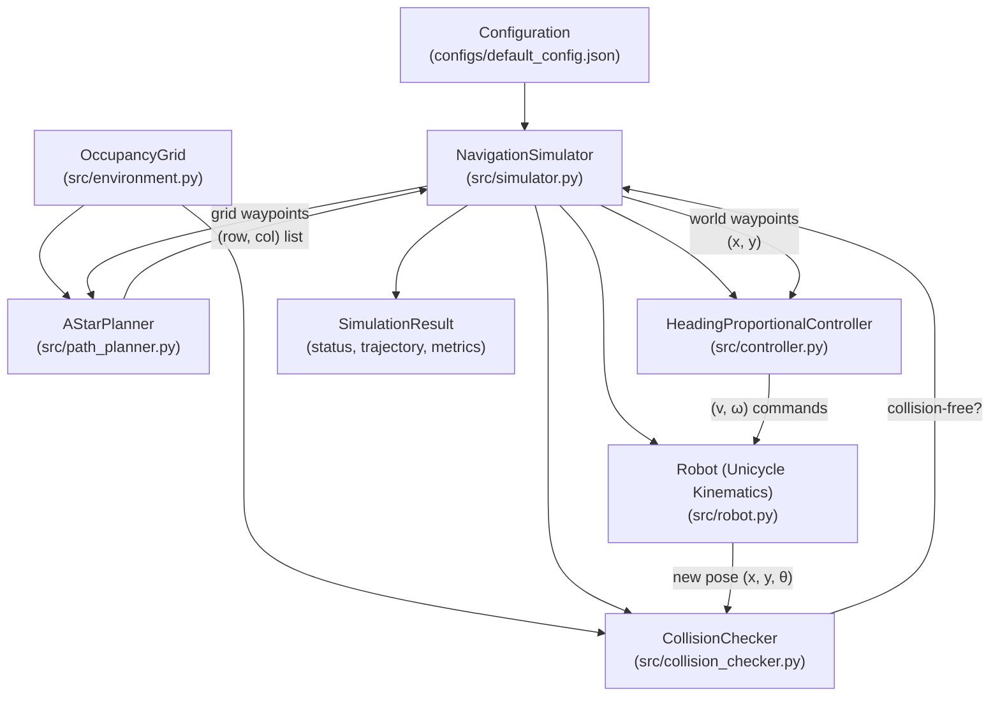

# System Architecture

This document defines the architecture of the **AI-Based Autonomous Navigation System** - a deterministic 2D autonomous navigation simulator implemented in Python.

---

## 1. Architectural Overview

The system follows a **modular sense-plan-act pipeline**, where each stage is a self-contained Python module with well-defined inputs and outputs. There is no machine learning - all decision-making is algorithmic.



---

## 2. Component Hierarchy & Responsibilities

| Module | Class | Responsibility | Input | Output |
| :--- | :--- | :--- | :--- | :--- |
| `src/environment.py` | `OccupancyGrid` | Stores 2D obstacle grid. Converts between grid (row, col) and world (x, y) coordinates. | `np.ndarray` of 0s and 1s | Grid queries, coordinate transforms |
| `src/path_planner.py` | `AStarPlanner` | Finds shortest collision-free 4-connected path on the grid using A* search with Manhattan heuristic. | `OccupancyGrid` + start/goal `(row, col)` | `List[(row, col)]` or `None` |
| `src/robot.py` | `Robot` | Unicycle kinematic model. Advances `(x, y, θ)` by forward Euler integration given `(v, ω, dt)`. | Velocity commands + `dt` | Updated pose `(x, y, θ)` |
| `src/controller.py` | `HeadingProportionalController` | Proportional heading controller. Computes `(v, ω)` to steer robot toward a target waypoint. | Current pose + target `(x, y)` | `(v_cmd, ω_cmd)` |
| `src/collision_checker.py` | `CollisionChecker` | Checks whether a circular robot footprint at a world pose is collision-free against occupied grid cells and map boundaries. | Pose `(x, y)` + `OccupancyGrid` | `bool` |
| `src/simulator.py` | `NavigationSimulator` | Orchestrates the full closed-loop simulation: plans path, runs control loop, checks collisions, logs trajectory. | Start/goal world coords + config | `SimulationResult` |

---

## 3. Simulation Loop Architecture

Each simulation run executes the following discrete-time loop at interval `dt`:

```
1. A* PLAN       → Compute grid path from start to goal
2. CONVERT       → Transform grid waypoints to world coordinates
3. LOOP (each dt step):
   a. GOAL CHECK     → If distance to goal ≤ tolerance → SUCCESS
   b. WAYPOINT ADV   → If near current waypoint, advance to next
   c. CONTROL        → Controller produces (v, ω) toward waypoint
   d. KINEMATICS     → Robot integrates forward by dt
   e. COLLISION      → Check new pose against obstacles
   f. STEP GUARD     → If steps > max_steps → TIMEOUT
   g. LOG            → Record RobotState snapshot
```

---

## 4. Termination Conditions

| Status | Condition |
| :--- | :--- |
| `SUCCESS` | Robot reaches within `goal_tolerance` of goal |
| `COLLISION` | Robot footprint overlaps obstacle or exits map |
| `TIMEOUT` | Step count exceeds `max_steps` |
| `NO_PATH` | A* finds no path from start grid cell to goal grid cell |

---

## 5. Explicit Scope Boundaries

### In Scope (Current Version)
- Deterministic 2D occupancy grid simulation
- A* path planning (4-connected, Manhattan heuristic)
- Unicycle forward-Euler kinematics
- Heading-based proportional (P) controller
- Circle-vs-rectangle collision checking
- Automated pytest test suite (79 tests)

### Out of Scope
- ROS 2, Gazebo, CARLA, or any robotics middleware
- OpenCV, YOLO, or any computer vision
- PyTorch, TensorFlow, or any machine learning
- SLAM, localization, or sensor fusion
- Physical hardware deployment
- Dynamic obstacles or 3D environments
