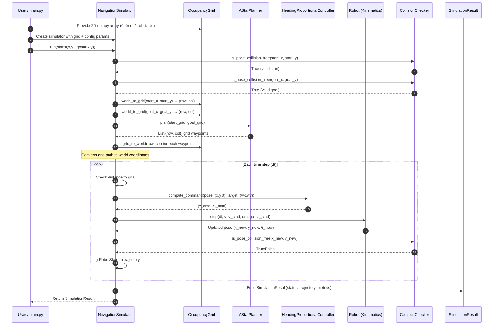

# Data Flow Architecture

This document traces how data flows through the **AI-Based Autonomous Navigation System** from input configuration to simulation result output.

---

## 1. End-to-End Data Flow Diagram

---

## 2. Stage-by-Stage Data Breakdown

### Stage 1: Environment Setup
- **Input**: 2D NumPy array `M ∈ {0, 1}^{H×W}`, resolution (m/cell), origin `(ox, oy)`
- **Output**: `OccupancyGrid` object with validated internal state
- **Data Format**: `np.int8` internal grid, `float` resolution and origin

### Stage 2: Simulator Construction
- **Input**: `OccupancyGrid` + configuration parameters (`dt`, `max_steps`, `goal_tolerance`, `robot_radius`, `linear_speed`, `angular_gain`, `angular_speed_limit`)
- **Output**: Internally creates `AStarPlanner`, `HeadingProportionalController`, `CollisionChecker`
- **Data Flow**: Grid reference is shared (not copied) between planner, collision checker

### Stage 3: Path Planning (A* Search)
- **Input**: Start and goal as grid coordinates `(row, col)`
- **Internal Processing**: Priority queue, g-score dictionary, came-from parent map
- **Output**: Ordered list of `(row, col)` waypoints from start to goal, or `None`
- **Data Size**: Proportional to grid area in worst case

### Stage 4: Coordinate Conversion
- **Input**: Grid waypoints `[(row₀, col₀), (row₁, col₁), ...]`
- **Conversion**: `grid_to_world(row, col, center=True)` → `(x, y)` at cell center
- **Output**: World-coordinate waypoints `[(x₀, y₀), (x₁, y₁), ...]`

### Stage 5: Control Loop (per step)
- **Controller Input**: Robot pose `(x, y, θ)` + current waypoint `(wx, wy)`
- **Controller Output**: `(v_cmd, ω_cmd)` - linear and angular velocity commands
- **Data Types**: All `float` values in SI units (m/s, rad/s)

### Stage 6: Kinematics Integration
- **Input**: Current state `(x, y, θ, v, ω)` + time step `dt`
- **Computation**: Forward Euler: `x += v·cos(θ)·dt`, `y += v·sin(θ)·dt`, `θ += ω·dt`
- **Output**: Updated robot pose `(x_new, y_new, θ_new)`

### Stage 7: Collision Checking
- **Input**: Robot world position `(x, y)` + robot radius `R`
- **Processing**: Boundary check → scan occupied cells in AABB → circle-rectangle distance
- **Output**: `bool` - True if collision-free

### Stage 8: Result Assembly
- **Output Data Structure** (`SimulationResult`):

| Field | Type | Description |
| :--- | :--- | :--- |
| `status` | `SimulationStatus` | SUCCESS, COLLISION, TIMEOUT, or NO_PATH |
| `steps` | `int` | Number of simulation steps executed |
| `trajectory` | `List[RobotState]` | Ordered state snapshots `(x, y, θ, v, ω)` |
| `planned_path_grid` | `List[(int,int)]` or `None` | A* path in grid coords |
| `planned_path_world` | `List[(float,float)]` or `None` | A* path in world coords |
| `start_world` | `(float, float)` | Start position |
| `goal_world` | `(float, float)` | Goal position |
| `path_length` | `float` | Total Euclidean distance traversed (meters) |
| `message` | `str` | Human-readable outcome description |
